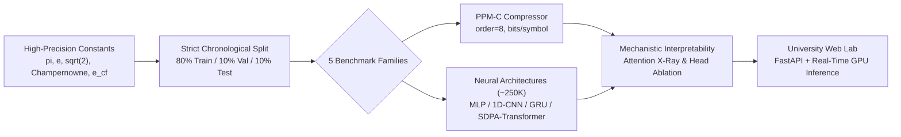

```text
┌─────────────────────────────────────────────────────────────────────────┐
│  w0rsty@rtx3060ti:~/research$ whoami                                    │
│  > ML Engineering & Mechanistic Interpretability Researcher             │
│  > Location: Kursk -> St. Petersburg (Target: ITMO AI360 / ML Native)   │
│  > Status:   [ACTIVE] Exploring limits of pseudorandomness & circuits   │
└─────────────────────────────────────────────────────────────────────────┘
```

### `[0x01]` Research Pipeline & Architecture



---

### `[0x02]` Flagship Repository: `Pi-Predictability-Lab`

Исследование границ предсказуемости математических констант, криптографических ГПСЧ и детекции скрытых алгоритмических закладок в псевдослучайном шуме.

$$H_{\text{Shannon}} = -\sum_{i=0}^{r-1} p_i \log_2 p_i = \log_2(10) \approx 3.3219 \text{ bits/symbol}$$

```text
EXPERIMENT SUMMARY (NVIDIA RTX 3060 Ti | FP16 Tensor Cores | Seed = 42)
═══════════════════════════════════════════════════════════════════════════════
Sequence               Baseline (PPM-C)   Neural Best (MLP/CNN/GRU)   Verdict
───────────────────────────────────────────────────────────────────────────────
True Pi (H0)           3.774 bits         3.322 bits (10.09%)         [NOISE]
Pi Continued Frac.     1.798 bits         1.598 bits (69.32%)         [GAUSS-KUZMIN]
e Continued Frac.      2.312 bits         0.0005 bits (99.996%)       [ARITHMETIC]
Champernowne C10       3.637 bits         0.0003 bits (99.998%)       [INCREMENT +1]
Hacked Pi (Tier 2)     0.598 bits         0.00002 bits (100.0%)       [TRIGGER FOUND]
═══════════════════════════════════════════════════════════════════════════════
```

Табличный компрессор `PPM-C` переобучается на редких суффиксах (`3.774 > 3.322` бит на $\pi$) и слепнет на новых разрядах в постоянной Чемперноуна (`19.99%`), тогда как нейросети выучивают сам арифметический закон (`99.998%`), а карты внимания подсвечивают скрытые триггеры в замаскированном шуме.

* **Repository:** [`github.com/w0rsty/Pi-Predictability-Lab`](https://github.com/w0rsty/Pi-Predictability-Lab)

---

### `[0x03]` Compute & Technical Stack

| Layer | Technologies & Methods |
| :--- | :--- |
| **Deep Learning** | `PyTorch` (Native `SDPA`, `Weight Tying`, `AMP`), `1D-CNN`, `GRU`, `Causal Transformer` |
| **Baselines & Math** | `PPM-C` (Suffix Context Tree), `LightGBM`, `mpmath` (Lehmer's CF Algorithm), `SciPy` |
| **Interpretability** | Attention X-Ray, Causal Head Ablation, PCA Embedding Geometry, Linear Probing |
| **Statistics** | Wilson 95% Score CI, McNemar's Test, $\chi^2$ Goodness-of-Fit, Cross-Entropy Bitrate |
| **Backend & UI** | `FastAPI`, `Uvicorn`, `Plotly`, `PyEcharts`, `pytest` |
| **Local Hardware** | `NVIDIA RTX 3060 Ti` (8 GB VRAM, CUDA 12.x, Tensor Cores) |

---

### `[0x04]` Active Roadmap `>>>`

* `[x]` **Phase 1–3.5:** Leakage-free pipeline, 4 neural families (`~250K` params), Attention X-Ray & `PPM-C` benchmark.
* `[/]` **Phase 4:** Multi-constant battle (`e_cf` vs `pi_cf`, Champernowne), Base-2/10/16 BBP oracle, scaling laws & Mechanistic Interpretability.
* `[ ]` **Phase 5:** Three-mode University Web Laboratory (`Academic Theory` / `Neural X-Ray` / `Applied Crypto Auditor`).

---

```text
w0rsty@rtx3060ti:~/research$ echo "Contact: Telegram @w0rsty | Email: domogarov2010@gmail.com"
```
